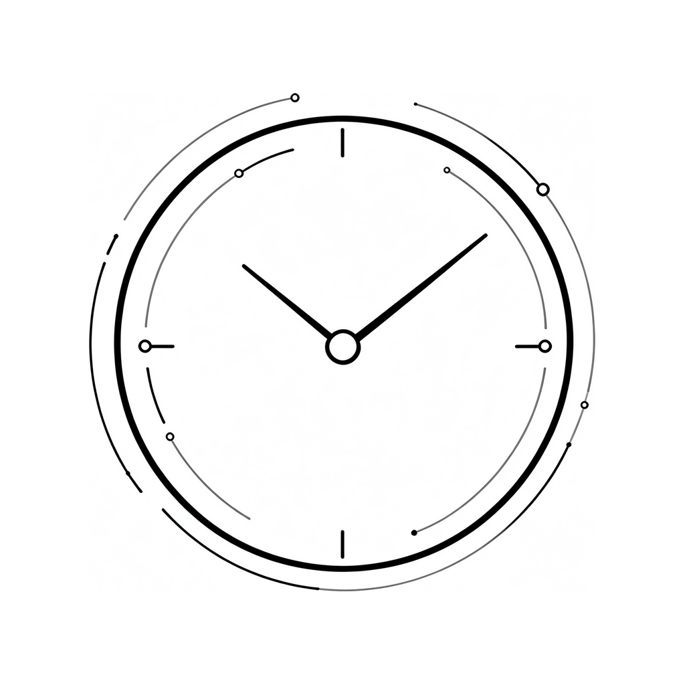

# 拾光 Lumina

<p align="center">
  
</p>

<p align="center">
  本地优先的 Windows 桌面效率工具：时钟、日历、待办、剪贴板、截图、专注、便签与密码管理器。
</p>

<p align="center">
  <a href="https://github.com/wanyjp/Lumina/actions/workflows/ci.yml"></a>
  <a href="https://github.com/wanyjp/Lumina/releases"></a>
  <a href="LICENSE"></a>
  
  
</p>

**English overview:** Lumina (拾光) is a local-first productivity suite for Windows, built with WPF and .NET 10. It combines a clock, calendar, todos, clipboard history, screenshot/OCR, countdowns, focus statistics, notes, and a locally encrypted password vault. No account, no cloud upload, and no telemetry.

---

## 1. 项目简介

拾光 Lumina 把日常高频的小工具收进一个桌面应用：主控面板承载完整操作，桌面小组件常驻显示，托盘负责后台驻留与快速入口。所有普通数据保存在本机 SQLite，截图与图片保存在本地目录，密码类数据使用主密码派生密钥加密。

设计原则：

- **本地优先**：不建立云端账号，不主动上传用户数据。
- **能力真实**：系统能力用 Windows API 实现；无法实现的能力明确降级，不伪装成功。
- **分层解耦**：业务层不直接依赖 WPF、SQLite 或 Win32，系统能力统一收敛到适配层。
- **数据可控**：数据库可导出备份、可恢复、可对账；卸载默认保留用户数据。

## 2. 功能特性

| 模块 | 主要能力 |
| --- | --- |
| 时钟 | 数字时钟、世界时钟（约 160 城市 + 固定偏移）、计时器、秒表、番茄钟、白噪音混音 |
| 日历日程 | 横向/纵向月历、农历节气节假日、日程增删改查、跨天日程、重复规则、提醒 |
| 待办 | 快速录入、四档完成风格、优先级、筛选排序、逾期标记、便签转待办 |
| 剪贴板 | 文本/图片/文件等五类历史、去重计数、多来源合并与来源查看、标签、固定、软删除、隐私排除、浮窗 |
| 截图取色 | 区域/全屏/窗口/延时截图、标注、贴图、OCR、取色与历史色板 |
| 倒计时 | 周期锚点、紧迫分档、桌面小组件、放大态 |
| 专注统计 | 专注会话记录、每日目标、热力图、周期统计与导出 |
| 便签 | Markdown/清单、自动保存、放大滚动、桌面小组件、转待办 |
| 密码管理器 | 本地加密、主密码创建/修改/安全问题找回、自动锁定、密码生成器、安全复制 |
| 设置中枢 | 五档主题、快捷键、组件、提醒、数据备份与恢复、首次运行引导 |

其他能力：系统托盘、开机自启、9 项全局/模块快捷键、桌面小组件、单实例启动、EULA、数据目录回退。

## 3. 界面

<p align="center">
  
</p>

公开仓库暂不附带阶段开发截图，避免包含个人日程、便签或剪贴板内容。安装后可直接体验完整界面；后续会在 `docs/images/` 补充经过脱敏的正式截图。

## 4. 系统要求

- Windows 11（推荐）或 Windows 10 2004（build 19041）及以上，64 位；
- 安装版自带 .NET 运行时，无需单独安装；
- 从源码构建需要 .NET 10 SDK（`global.json` 允许向上滚动到更高主版本）。

## 5. 下载与安装

从 [GitHub Releases](https://github.com/wanyjp/Lumina/releases) 下载最新安装包：

```text
Lumina-1.0.0-win-x64-setup.exe
```

安装步骤：

1. 运行安装包，阅读并接受最终用户许可协议；
2. 选择“仅为我安装”（默认，免管理员）或“为所有用户安装”（UAC）；
3. 可选桌面快捷方式、开机自启；
4. 首次启动会显示引导：主题、开机自启、剪贴板隐私说明、主密码入口。

安装包未进行代码签名，Windows SmartScreen 或杀毒软件可能提示；请核对 Release 页面提供的 SHA-256 后再运行。

## 6. 首次启动与数据位置

用户数据固定保存在：

```text
%APPDATA%\Lumina\
```

程序目录与数据目录分离：升级、卸载或移动程序目录都不影响数据。卸载默认只删除程序文件与快捷方式，保留 `%APPDATA%\Lumina`；如需彻底清除，请先导出备份再手动删除。

数据目录包含数据库、截图/剪贴板图片、便签附件、备份、日志与配置。若 `%APPDATA%` 不可写，应用会依次回退到 `%LOCALAPPDATA%` 和 `%TEMP%`。

## 7. 从源码构建

### 7.1 环境

- Windows 10 2004+ / Windows 11；
- .NET 10 SDK；
- 构建安装包需要 Inno Setup 7（`ISCC.exe`）；
- PowerShell 5.1 或 PowerShell 7。

### 7.2 构建与测试

```powershell
dotnet restore Lumina.sln
dotnet build Lumina.sln -c Release
dotnet test Lumina.Tests\Lumina.Tests.csproj -c Release

# 完整门禁：分层检查 + 构建 + 单测 + 格式
pwsh .\scripts\verify.ps1
```

### 7.3 构建安装包

```powershell
# 不含白噪音音源，适合本地验证安装器
pwsh .\scripts\build-release.ps1 -SkipAudio

# 含音源：将音频放入 AudioSource 指定的目录后执行
pwsh .\scripts\build-release.ps1 -AudioSource .\path\to\app_audio
```

白噪音资源包体积约 1.16 GB，不纳入 Git；公开仓库只保留 `THIRD-PARTY-AUDIO.md` 作为来源与许可记录。缺少音频时，白噪音模块会降级为空分类并提示资源包缺失，不影响其他功能。

## 8. 项目结构

```text
Lumina.sln
├─ Lumina.Domain          领域模型、枚举、存储接口（纯 .NET）
├─ Lumina.Data            SQLite、迁移、仓储、备份与恢复
├─ Lumina.Services        业务服务、配置、主题、热键、通知、保险库
├─ Lumina.SystemAdapters  Win32/WinRT 适配：剪贴板、截图、音频、OCR、自启、加密
├─ Lumina.UI.Wpf          WPF 视图、ViewModel、控件、主题与首次引导
├─ Lumina.Widgets         桌面小组件宿主、玻璃材质、布局持久化
├─ Lumina.App             组合根、托盘、启动看门狗、安装包入口
├─ Lumina.Tests           xUnit v3 自动化测试
├─ installer              Inno Setup 安装器脚本与 EULA
└─ scripts                构建、校验与分层检查脚本
```

## 9. 架构与分层

- `Lumina.Domain`、`Lumina.Data`、`Lumina.Services` 为纯 .NET 类库，不依赖 WPF；
- 表现层只依赖服务接口，不直接写 SQL、不直接调用 Win32/WinRT；
- 系统能力统一封装在 `Lumina.SystemAdapters`，便于替换与测试；
- 单进程多窗口：主控面板、桌面小组件与托盘共享同一服务单例与数据连接；
- 数据迁移采用“新增列 + 回填 + 兼容读取”，迁移前自动备份，失败可回滚。

## 10. 数据、隐私与安全

- 普通数据落本地 SQLite（WAL 模式），截图与图片落本地文件目录；
- 密码管理器使用 PBKDF2-SHA256（600,000 次迭代）派生密钥，AES-GCM 加密字段；主密码只保存校验哈希；
- 剪贴板支持排除规则、忽略应用、敏感内容识别与安全复制定时清除；
- 日志不记录密码、主密码或剪贴板正文；
- 应用不包含网络请求，断网可完整使用；
- 备份为整库快照，不含 `files\` 下的图片/附件，需要时请整体复制数据目录。

## 11. 测试与质量

- 自动化测试：**617 项通过**（0 失败、0 跳过）；
- CI：GitHub Actions 在 Windows Runner 上执行 `scripts/verify.ps1`；
- 门禁：Release 构建 0 警告 0 错误、格式检查、分层依赖检查、全量单测；
- 数据库 schema：v11；迁移、备份恢复、孤儿文件对账与接口冻结均有测试覆盖。

## 12. 已知限制

- 安装包未签名，SmartScreen/杀软可能提示；
- Windows 10 22H2 为尽力兼容，主要验证环境为 Windows 11；
- 白噪音资源包不随 Git 仓库分发，需使用官方安装包或自行提供音频；
- OCR 依赖 Windows 系统语言能力，部分语言包需要手动安装；
- 不提供云端同步、多端同步或在线备份；
- 公开源码树使用原创合成提示音，不包含第三方音效素材。

## 13. 参与贡献

欢迎提交 Issue 与 Pull Request。开始前请阅读：

- [CONTRIBUTING.md](CONTRIBUTING.md)：分支、提交、测试与 PR 要求；
- [CODE_OF_CONDUCT.md](CODE_OF_CONDUCT.md)：社区行为准则；
- [SECURITY.md](SECURITY.md)：漏洞私密报告方式。

## 14. 许可证

- 源代码：[MIT License](LICENSE)；
- “拾光 Lumina”名称、标识、图标与品牌资源不适用 MIT License，未经书面许可不得以官方名义分发修改版；
- 第三方组件、音频、字体与图标按各自许可使用，详见 [THIRD-PARTY-NOTICES.md](THIRD-PARTY-NOTICES.md) 与 [THIRD-PARTY-AUDIO.md](THIRD-PARTY-AUDIO.md)。

## 15. 第三方资源与致谢

感谢所有开源组件与音频素材的作者。完整清单、版本、许可与来源链接见：

- [THIRD-PARTY-NOTICES.md](THIRD-PARTY-NOTICES.md)
- [THIRD-PARTY-AUDIO.md](THIRD-PARTY-AUDIO.md)

## 16. 安全披露

请不要在公开 Issue 中披露未修复的安全漏洞。请通过 GitHub 的 Private vulnerability reporting 或 `SECURITY.md` 中的方式联系维护者。
